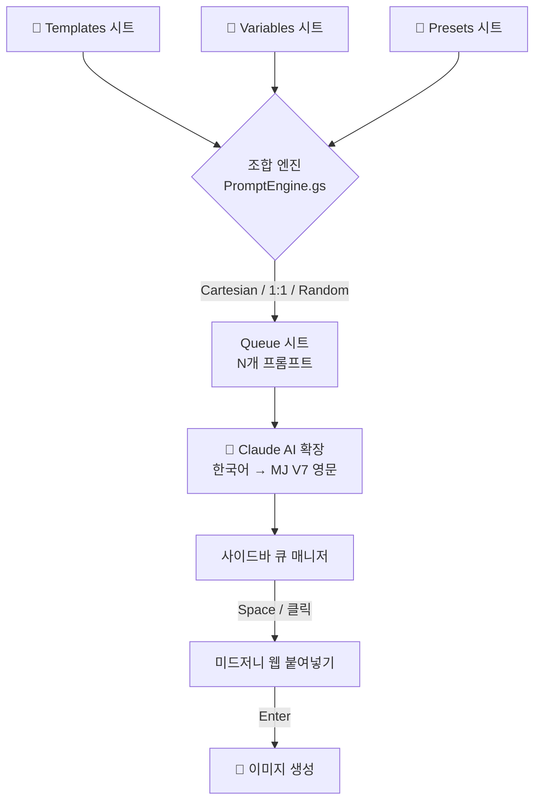

# 🎨 MJ Prompt Factory

### *한국어 콘셉트 → Midjourney V7 최적화 영문 프롬프트, 자동으로*

**Google Sheets + Apps Script + Claude AI로 구축하는 미드저니 배치 프롬프트 생산 공장**

[](https://github.com/Reasonofmoon/mj-prompt-factory)
[](https://script.google.com)
[](https://console.anthropic.com)
[](https://ai.google.dev)
[](LICENSE)

> **"미드저니 프롬프트 작성에 왜 이렇게 시간이 걸리는가?"**  
> 템플릿 × 변수 조합 엔진 + Claude AI 번역으로 100개 프롬프트를 **5분**에 생성합니다.

[📖 튜토리얼](TUTORIAL.md) · [🐛 이슈](../../issues)

---

## 🧠 Philosophy — "왜 만들었는가"

미드저니 V7 고품질 이미지 생성의 병목은 **프롬프트 작성**입니다.

| 기준 | 수동 작성 | MJ Prompt Factory |
|------|-----------|------------------|
| 100개 프롬프트 생성 | 2~4시간 | **5분** |
| 한국어 → 영문 최적화 | 구글 번역 + 수동 조정 | **Claude AI 자동 변환** |
| 프롬프트 재사용 | 개인 메모장 | **Sheets 템플릿 라이브러리** |
| 투입 순서 관리 | 복붙 반복 | **사이드바 순차 복사 큐** |
| 완료 추적 | 불가 | **대기/복사/완료/스킵 상태** |



---

## ⚙️ 시스템 레이어

### Layer 1 · 조합 엔진 (PromptEngine.gs)
- **Cartesian Mode**: 템플릿 × 변수 모든 조합 생성
- **1:1 Mode**: 행 순서 1대1 매핑
- **Random Mode**: 무작위 샘플링

### Layer 2 · AI 확장 (ClaudeApi.gs + GeminiApi.gs)
- Claude 3.5 Sonnet: 한국어 콘셉트 → MJ V7 최적화 영문
- Gemini Flash: 빠른 키워드 추출 및 스타일 분류

### Layer 3 · 큐 매니저 (Sidebar.html)
- 실시간 프로그레스 바
- 키보드 단축키: `Space`(복사), `←→`(이동), `S`(스킵), `D`(완료)
- 상태 지속: Google Sheets 실시간 동기화

> **Wow Moment**: "Generate Prompts" 클릭 → **30초** 안에 100개 큐 완성

---

## 🚀 빠른 시작

### 1. Google Sheets 설정
```
1. Google Sheets 새 스프레드시트 생성
2. 확장 프로그램 > Apps Script 열기
3. 아래 6개 파일 복사:
   - Code.gs, SheetSetup.gs, PromptEngine.gs
   - ClaudeApi.gs, QueueManager.gs, Sidebar.html
4. onOpen 함수 실행 → 권한 허용
```

### 2. 초기화
```
스프레드시트에서: 🎨 MJ Prompt Factory > Initialize Sheets
→ Templates, Variables, Queue, Presets 시트 자동 생성
```

### 3. Claude AI 연결 (선택)
```
🎨 MJ Prompt Factory > Claude AI > Set API Key
→ Anthropic Console에서 발급한 API 키 입력
```

---

## 🎯 수준별 활용 가이드

### 🟢 Starter — "첫 배치 생성"
1. Templates 시트에 기본 템플릿 입력: `{subject}, {style}, cinematic lighting`
2. Variables 시트에 값 입력: subject = [forest, city, ocean]
3. Generate Prompts > Cartesian → 3개 프롬프트 생성
4. 사이드바 열기 → Space로 순차 복사

### 🔵 Professional — "AI 확장 활용"
1. 한국어로 콘셉트 작성: "달빛 아래 서울 골목길 레트로 감성"
2. Claude AI > Expand Prompt로 MJ V7 최적화 영문 변환
3. Presets 시트 스타일 라이브러리 구축

### 🟣 Enterprise — "팀 프롬프트 표준화"
1. 공유 스프레드시트로 팀 템플릿 라이브러리 구축
2. Google Drive 이미지 참조 시스템 연동
3. 자동 아카이빙 (완료된 프롬프트 → Archive 시트)

---

## 📋 시트 구조

| 시트 | 역할 |
|------|------|
| Templates | 프롬프트 뼈대 + `{placeholder}` |
| Variables | placeholder별 값 목록 |
| Queue | 생성된 프롬프트 + 상태 (대기/복사/완료/스킵) |
| Presets | 재사용 가능한 스타일/카메라/조명 세트 |

---

## 🔧 확장 가이드

| 우선순위 | 방법 | 난이도 | 효과 |
|----------|------|--------|------|
| **1st** | Variables 시트 값 추가 | ⭐ | 즉시 프롬프트 양 확대 |
| **2nd** | `PromptEngine.gs` 모드 조정 | ⭐⭐ | 조합 알고리즘 커스텀 |
| **3rd** | `ClaudeApi.gs` 시스템 프롬프트 | ⭐⭐⭐ | AI 번역 품질 최적화 |

---

## 📋 License

MIT © [Reasonofmoon](https://github.com/Reasonofmoon)
